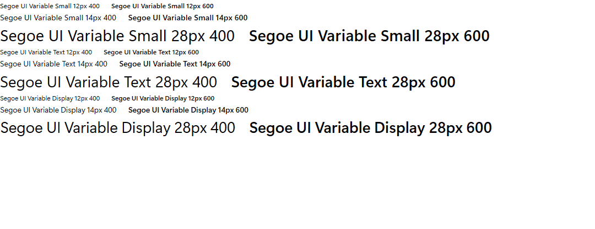
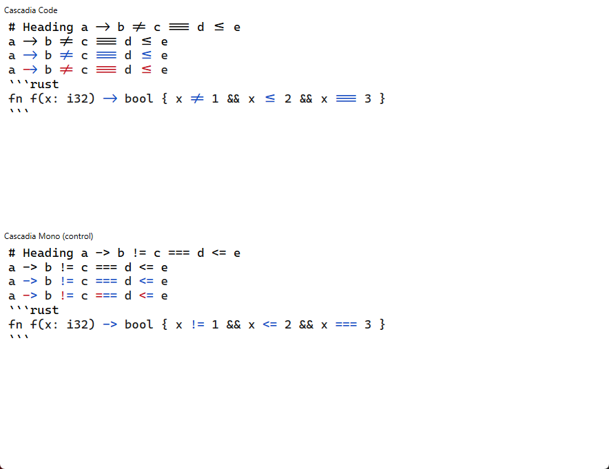
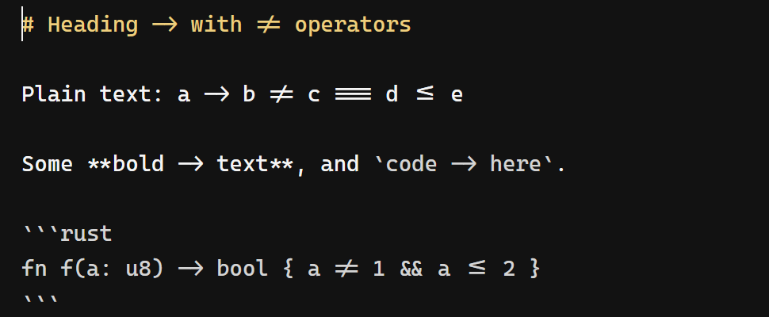
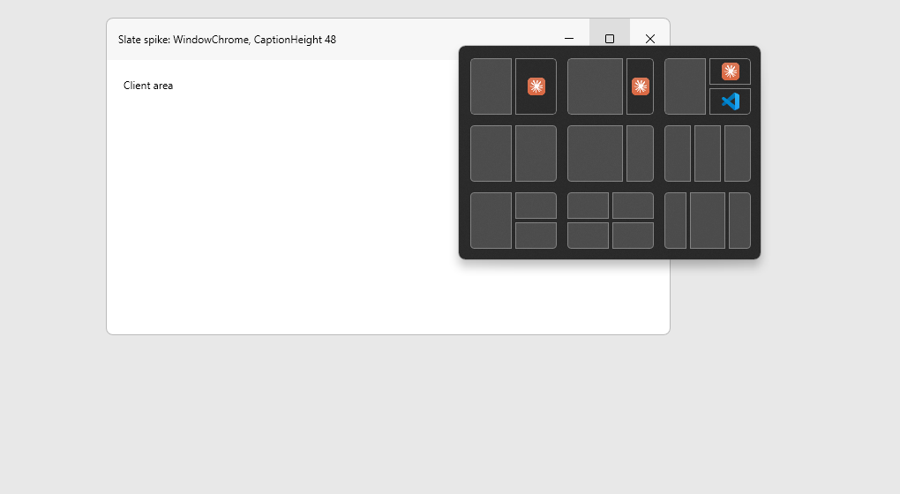
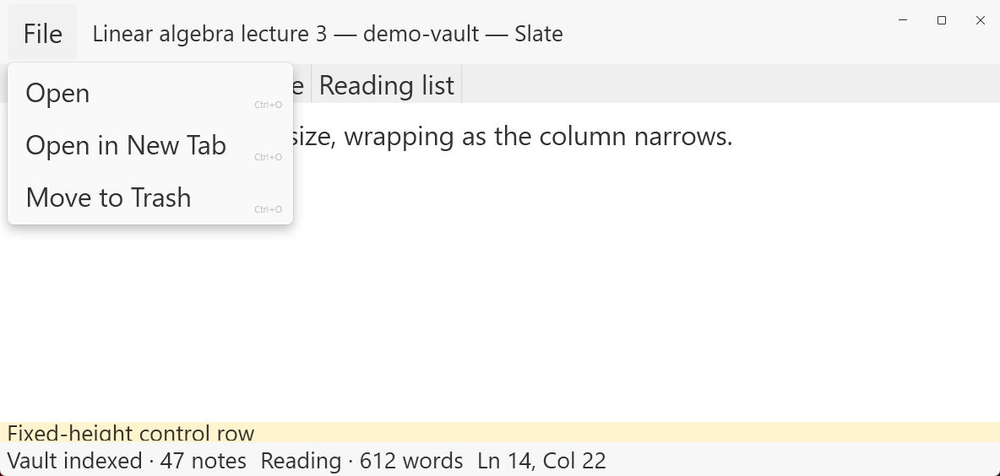
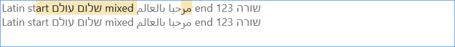
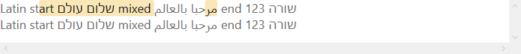

# Can WPF build this design system?

Checked on 1 November 2026 against:
- Slate's Windows app on `main` (`coryj627/slate`, `apps/slate-windows`): `SlateWindows.csproj`, `App.xaml.cs`, `ThemeManager.cs`, `Themes/Slate.*.xaml`, `MainWindow.xaml`.
- The WPF Fluent theme source on `main` (`dotnet/wpf`, `src/Microsoft.DotNet.Wpf/src/Themes/PresentationFramework.Fluent`).
- Microsoft Learn and WPF design notes (listed at the end).

## Short answer

Yes. Nothing in the system needs WinUI. Slate already runs on .NET 10, merges the Fluent theme dictionaries itself and loads its own `Slate.Light / Dark / Contrast` dictionaries after them, so most of the system is a resource layer on top of what ships.

Four areas need real engineering:
1. **Recolouring Fluent controls.** Done in #1755. Slate's theme files now override Fluent's brush keys, so check boxes, accent buttons, sliders, focus rings and menus use the gold and neutrals this system specifies. A control with a local style loses those overrides and falls back to WPF's classic style, so #1758 points the system colours at the same tokens. WPF's classic `ListBoxItem` and `TabItem` templates also hard-code some colours, so both now have their own templates. A subclass of a control gets no Fluent style either, because implicit styles are keyed on the exact type, so a subclass sets it in its constructor. Every local `ListBox`, `ListBoxItem`, `Button` and `TreeViewItem` style has to be based on its Slate base, and a test enforces it.
2. **Menus.** WPF's Fluent `MenuItem` template causes the misalignment seen in the Editor menu and draws shortcut text in the disabled colour.
3. **The 48px title bar.** Slate uses the standard Windows title bar today. The merged title bar needs `WindowChrome` plus a native hook for Snap Layouts.
4. **Text scaling.** WPF doesn't apply the Windows "Make text bigger" setting to fixed font sizes. WinUI does.

Three things should change in the design system rather than in the app: the two-layer shadows, the optional Mica title bar, and the Material acrylic component. All three changed on 1 November 2026 (see Shadows and Mica and acrylic).

The six spikes ran on 2 November 2026 and none failed (see Spikes to run first). They confirm the approach for all four areas of engineering above, and they don't reduce the work. They added two requirements for the menu template.

## Ratings

- **Native:** the Fluent theme already does it. Override resource keys only.
- **Template:** new `Style` or `ControlTemplate` on an existing WPF control.
- **Build:** behaviour WPF doesn't have. Needs code or a custom control.
- **Change the design:** WPF can't do it well. Adjust the system.

| Area | Rating | What it takes |
| --- | --- | --- |
| Colour tokens, light and dark | Native | Override Fluent's **brush** keys in the Slate dictionaries (see Colour) |
| High Contrast | Native | Keep `Fluent.HC` + `Slate.Contrast`; never apply gold there |
| Type ramp, sizes, line heights | Native | CSS px = WPF device-independent pixels, so values carry over 1:1; the app's are dynamic keys (`TypeRamp`, #1803), because Fluent's styles can't scale |
| Segoe UI Variable | Native | Use the named families; spike 1 confirmed them on Windows 11 |
| Text scaling | Build | Scale font sizes yourself; spike 5 confirmed `MinHeight` rows grow without clipping |
| Icons | Native | `SymbolThemeFontFamily`; name every icon-only control |
| Radii, strokes | Native | 4 and 8 match Fluent; tabs' top corners need a template |
| Hover and pressed | Template | Map overlays to Fluent's state brushes |
| Shadows | Change the design | One shadow per element; on a sibling of the text, with the ClearType hint (spike 4) |
| Motion | Native | Storyboards with the same curves and durations |
| Focus ring | Native | Fluent's ring already sits where the tokens put it |
| Text selection | Native, with a switch | Turn off adorner selection for solid gold; spike 6 confirmed it with right-to-left text |
| Menus | Template | One shared template for every row type; it scales shortcut text and fits the top-level item in 48px |
| Tooltips | Native | Keyboard tooltips are built in |
| Title bar | Build | `WindowChrome` + `WM_NCHITTEST` hook; spike 3 confirmed Snap Layouts opens |
| Mica, acrylic | Change the design | Conflicts with Slate's solid-surface policy |
| Narrow-width layouts | Build (small) | No `AdaptiveTrigger` in WPF |

## Colour

**Native, with one trap.** The Fluent theme builds its accent brushes from `SystemAccentColor` with `StaticResource`, which is resolved once when the dictionary loads. Redefining `SystemAccentColor` in a later dictionary changes nothing. Control styles read the **brushes** with `DynamicResource` (for example `AccentButtonBackground`), so override the brush keys in `Slate.Light.xaml` and `Slate.Dark.xaml`. Slate already merges these last, and the last merged dictionary wins.

- There are 163 accent references in Fluent's theme files, plus the neutral families (`TextFillColor*`, `ControlFillColor*`, `ControlStrokeColor*`, `CardBackgroundFill*` and the solid backgrounds). **Done:** `xaml/Slate.Light.xaml` and `xaml/Slate.Dark.xaml` are generated from the tokens and override 81 accent brushes and about 267 neutral brushes. The accent brushes read nine accent-role colours with `DynamicResource`, so the Windows accent can replace gold at runtime (`xaml/README.md`).
- Colour formats differ: CSS 8-digit hex is `#RRGGBBAA`, XAML is `#AARRGGBB`. Convert `rgba()` values to ARGB.
- High Contrast: leave Fluent's HC dictionary and `Slate.Contrast.xaml` (which maps to `SystemColors`) untouched. No gold overrides in HC.

## Type

- **Sizes and line heights: Native.** One CSS px is one WPF device-independent pixel, so 12/16, 14/20, 20/28 carry over unchanged. To get exact line heights, set `LineHeight` with `LineStackingStrategy="BlockLineHeight"`. The default strategy uses the tallest glyph instead. The tokens use no letter-spacing, which WPF `TextBlock` lacks.
- **Segoe UI Variable: Native.** WPF's Fluent theme sets only the icon font (`SymbolThemeFontFamily`), so text stays in plain Segoe UI unless the app sets `FontFamily`. WPF can't drive a variable font's axes (its DirectWrite layer has no font-axis APIs), so automatic optical sizing, which WinUI has, isn't available. That doesn't stop an embedded variable font giving its named instances: through a pack URI, `CascadiaCode.ttf` gives six named weights and `OpenSans-Variable.ttf` five, all with `StyleSimulations` of `None` (measured 3 November 2026). A folder reference such as `./#Open Sans` reaches the italic file, where a single-file reference simulates an oblique. Use the named families, as the tokens do: `Segoe UI Variable Small` at 12px, `Text` at 14–18px, `Display` from 20px, each falling back to `Segoe UI` (Windows 10 doesn't ship the variable font). The system only uses weights 400, 600 and 700, which WPF names directly. Spike 1 confirmed that WPF lists the three named families on Windows 11 and renders 400 and 600 without synthetic bolding.
- **Open Sans and Cascadia Code: Native.** The app embeds them as resources, linked from `fonts/`, so they draw on a machine that doesn't have them (#1802). An embedded family's source is a pack URI, and WPF hands the source on as the font's name. In UI Automation, NVDA would read it under Report Font Name, and in a copy's RTF font table, the URI's semicolon ends the entry early. The reading view answers with the family's name in both places (`ShippedFontNames`), and doesn't offer WPF's XAML clipboard formats, which carry it too. AvalonEdit passes the text area's family to the native IME as a face name, so the text area keeps a font Windows has and the text view inside it draws the composite. Spike 2 confirmed that Cascadia Code ligatures survive AvalonEdit's colour runs. A colour boundary inside an operator doesn't break the ligature, and the glyph takes the first run's colour or splits by cell. AvalonEdit has no line-height API (`VisualLineTextParagraphProperties` is internal and sealed, and `TextView.DefaultLineHeight` has no setter), so the editor reaches 14/22 through a composite font file: `LineSpacing="1.5714"` (22/14), `Baseline="1.1324"`, target `./#Cascadia Code`. Cascadia's natural 16.27 becomes exactly 22 at 14, and 12.57, 31.43 and 62.86 at 8, 20 and 40. The composite keeps Cascadia's width, its ligatures, real bold and italic, and fallback for other scripts (measured 3 November 2026).
- **Text scaling: Build.** WinUI applies the Windows "Make text bigger" setting automatically. WPF only applies it through `SystemFonts`: a control with no explicit `FontSize` grows, and fixed `FontSize` values stay as they are. Read `HKCU\Software\Microsoft\Accessibility\TextScaleFactor`, a percentage from 100 to 225, divide it by 100 to get the factor (1 when the value is missing, unreadable or under 100, and never above 2.25), multiply font sizes by the factor, and listen for `SystemEvents.UserPreferenceChanged`, as `TextScaleService` does. `UISettings.TextScaleFactor` is the documented API, but it's WinRT, and the standard route to it under `net10.0-windows` ships the whole Windows SDK projection, about 25 MB, for one number. That choice is plan 46's DSD3, and the owner's live check on 2026-11-04 confirmed it: a change made in Windows Settings reaches the running app. Microsoft's guidance is to scale small text more than large text and to leave icon glyphs unscaled. **Design impact (done):** the shell heights (48 title bar, 36 tab strip, 24 status bar) and the 32–36px rows are now minimums that grow with text (`--titlebar-min-height`, `--tabstrip-min-height`, `--statusbar-min-height`; `MinHeight` in WPF), up to 225%. The running shell needed more than spike 5 showed, because a real pane has less room than the spike's: `xaml/README.md` has what DS-5 settled.
- Expect WPF text to look slightly different from the HTML cards (different rasterizer). Judge type in the running app.

## Icons

**Native.** The Fluent theme's `SymbolThemeFontFamily` is `Segoe Fluent Icons, Segoe MDL2 Assets`. Windows 11 has Segoe Fluent Icons; Windows 10 doesn't ship it and falls back to MDL2, which uses the same code points for shared glyphs. Reference the resource, not the font name, and don't redistribute the font file. For Fluent System Icons (the SVG set), convert the single-path SVGs to `Path` geometry.

Every icon-only button needs `AutomationProperties.Name`. Otherwise Narrator reads the private-use glyph as the name. This is the same problem Slate already fixed for the TextBox clear button (#1106). The app has `Slate.SubtleIconButtonStyle`, with a 40 twin and a toggle: the glyph is presentation-only, so nothing is named by it, and `GlyphsNameNothingCensus` holds a name to every button that draws one.

## Shape, state and motion

- **Radii: Native.** Fluent's `ControlCornerRadius` is 4 and `OverlayCornerRadius` is 8, matching the system. Tabs' 8px top corners and the 3px selection pill go in templates.
- **1px strokes: Native.** Set `UseLayoutRounding="True"` on the window so lines stay crisp at 125% and 150% scaling.
- **Hover and pressed: Template.** The system describes states as overlays (4% / 8% black, 6% / 10% white in dark). Fluent controls use one solid brush per state (`ControlFillColorSecondary`, `ControlFillColorTertiary`), so set those keys to the overlay colours as composited on each surface. Slate-built rows can use semi-transparent brushes in their triggers directly.
- **Motion: Native.** Durations carry over unchanged. Each `cubic-bezier` token becomes a `KeySpline` with the same four numbers (decelerate-mid is `KeySpline="0,0,0,1"`). Skip animations when `SystemParameters.ClientAreaAnimation` is false (Windows "Animation effects" off).

## Shadows

**Change the design.** The shadow tokens are two layers each (a soft ambient layer plus a key layer). A WPF element takes one `DropShadowEffect`. Stacking two effects needs two elements and costs rendering time.

- `DropShadowEffect.Direction` defaults to 315°, which puts the shadow down and to the right. Fluent shadows fall straight down: set `Direction="270"`.
- CSS blur and WPF `BlurRadius` aren't the same unit. Tune by eye against the HTML elevation card.
- Effects turn off ClearType for the text inside them, and so do popups with `AllowsTransparency="True"`, which is every Fluent popup (menus, tooltips, ComboBox, DatePicker). Text there renders in greyscale. Put the effect on a background-only `Border` behind the content rather than on the content's parent, and set `RenderOptions.ClearTypeHint="Enabled"` on the opaque popup surface, and again below any `ScrollViewer` in it (see Menus). The hint has no effect on `TextBox`.
- **Done:** one shadow per level (2, 4, 8, 16, 28, 64), black at 18% (36% in dark). The CSS tokens and the Fluent components use the single layer, and `xaml/` has a `DropShadowEffect` per level (`Slate.Shadow2` … `Slate.Shadow64`, `Direction="270"`, `BlurRadius` = 1.5 × the CSS blur). Values are in `xaml/README.md` and on the Elevation card. The app's overlays use them on a sibling behind their content: `Slate.OverlayShadow28` for Quick Open, Search and the palette, `Slate.OverlayShadow64` for every other sheet, over the 30% scrim, and `Slate.Shadow8` the same way for a tooltip. Colour fringes on the palette's text went from 0% to 38%, which is what plain window text measures at 200% display scale.

## Focus and selection

- **Focus ring: Native.** WPF shows `FocusVisualStyle` only for keyboard focus, which matches `:focus-visible`. Fluent's default is a 2px ring with radius 4 on a `Rectangle` at `Margin="-3"`. A `Rectangle` strokes inside its bounds, so the ring's inner edge sits 1px outside the control and its outer edge 3px, which is exactly what the system says (`tokens/base.css`: a 2px outline, offset 1px). **Decision:** keep Fluent's. `Margin="-1"` would put the stroke across the control's border. Set `KeyboardFocusBorderColorBrush` to the focus-ring token. For list rows, Slate's row focus style draws inside the row, because a list clips Fluent's. A menu row's ring sits on its inset highlight (`readme.md`, Menu rules).
- **Text selection: Native, with a switch.** By default WPF draws TextBox selection as a translucent overlay (`SelectionOpacity`) and ignores `SelectionTextBrush`, so pale gold with dark text isn't guaranteed. Set the AppContext switch `Switch.System.Windows.Controls.Text.UseAdornerForTextboxSelectionRendering` to `false`, then set `SelectionBrush`, `SelectionTextBrush` and `SelectionOpacity="1"`. The app does this for every `TextBox` (`TextBoxSelection.cs`, #1755). Without it, the pale gold at the default 40% opacity is almost invisible on white. The reading view is a `RichTextBox`, which ignores the switch and always draws selection on top of the text, so it takes a translucent overlay instead (`Slate.ReadingSelectionBrush`, values in `xaml/README.md`). The editor sets AvalonEdit's `SelectionBrush` and `SelectionForeground` to the solid pair, because it draws selection under the text. It also sets `SelectionBorder`, because the gold selection is close to the find-match fill in both themes, and the border keeps the current match apart from the others.

## Menus

**Template.** Three problems in Fluent's `MenuItem.xaml`:
- **Rows don't line up.** Checkable rows have a check column, but rows that open a submenu don't, so their labels start further left. This is the Math / Code Preamble Verbosity misalignment in the Editor menu.
- **Shortcut text uses the disabled colour** (`TextFillColorDisabledBrush`, #5C000000 in light mode, about 2.5:1 on white) whether or not the item is enabled. The system requires secondary text, and at least 4.5:1 even for disabled items.
- **Checked rows draw a 20 × 20 check box** rather than the bare checkmark the system uses.

Spike 5 found two more:
- **Shortcut text doesn't scale.** It stays small at 2.25 even with the `MenuItem`'s `FontSize` set to 31.5, while the row's label grows.
- **The top-level item doesn't fit a 48px title bar.** Its text sits in 30px of Fluent's padding and margins. With 14px text, that makes the item about 49px tall before any margin of its own.

**Shipped (DS-4):** `Themes/Slate.Menus.xaml` serves all four roles. Each popup row uses the same three columns with `SharedSizeGroup`: one leading column, where a check replaces an icon, then the label, then one end column that the shortcut and the submenu chevron share (`readme.md`, Menu rules). Each popup's items host sets `Grid.IsSharedSizeScope`. The end column takes its size from the scaled text. `InputGestureText` and the `AcceleratorKey` binding are as they were. Rows are 40 with a 34 highlight inset 5,3, and the ring sits on the highlight (DSD10).

**Measured:** a top-level item is 32 tall at 14 point, against 49 in Fluent's template, so it fits the 48 title bar with 16 to spare. The bar is 32 too.

**ClearType needs the hint below the scroller.** Spike 4's setup, a hint on the opaque surface and the shadow on a sibling, gave no colour fringes at all in a real menu at 200%. The hint doesn't reach the text through the scroller's clip. With the hint on the items host as well, about 70% of a menu's text pixels carry fringes, as window text does. A host that clips loses them the same way, so the context menu's panel dropped Fluent's `ClipToBounds`. That's measured at 200% only, and why a clip does this wasn't established. The slide (radius 8, 3px vertical padding, 167ms) runs only when the system's animation setting allows it.

A popup is larger than its surface by the shadow's room, and WPF's placement modes flip without flipping their offsets, so popups open from a `PlacementRectangle` (`MenuPlacement.cs`) whose sides are where the surface has to land. That keeps WPF's own flip, slide and height limit, which a custom placement loses. A menu taller than the display scrolls, and Workspace's 25 rows at 40 are taller than a small one. WPF's menus don't handle Home or End, in Fluent's template or this one.

## Tooltips

**Native.** Since .NET Framework 4.8, WPF opens a tooltip when its control gets keyboard focus. Ctrl+Shift+F10 toggles it, and Esc or Ctrl alone closes it. From .NET 6, `ToolTipService.ShowsToolTipOnKeyboardFocus` turns this off per control (useful in the pane switcher if tooltips appear while arrowing through icons). A tooltip isn't the control's accessible name, so set `AutomationProperties.Name` as well.

## Title bar (48px, merged with the menus)

**Build.** The approach in readme.md (Window chrome) is right. What the code shows:
- Slate has no `WindowChrome` today, so this is new work.
- **Built in DS-12 (#1813).** Three things the spike didn't show. WPF asks the newest `HwndSource` hook first and WindowChrome adds its own as the source appears, so a hook added from a `SourceInitialized` handler is never asked over maximize: add it after `base.OnSourceInitialized`. `SystemParameters.WindowResizeBorderThickness` is the frame's sizing border alone, 2.5 against Windows' 6.5 at 200%, so the resize zone and the maximized padding take the padded border too. Windows places the Snap Layouts flyout for a standard caption, so it covers the lower 19 of a 48-tall button once it's open. And any glass frame, WindowChrome's default of the caption's height or even `0,0,0,1`, takes ClearType from the whole window: the menu bar's text measured 0% colour fringes against 53% with none. With DS-4's menu template the row stays 48 at 225% text size: the menu's items are 42 there.
- `WindowChrome` answers `WM_NCHITTEST` but never returns `HTMAXBUTTON`, so Snap Layouts won't open from a custom maximize button. Add an `HwndSource` hook that returns `HTMAXBUTTON` over the button. Windows then handles the mouse over that button itself, so the hook also has to drive the button's hover and pressed visuals.
- Microsoft recommends a minimum window width of 500 effective pixels or less (330 or less if possible) so Snap Layouts work. With a 260 sidebar and a 300 right pane, panes must collapse below that width. **Built in DS-14 (#1815):** the minimum is 500. 330 isn't taken: the menu row, the tab strip and the sheets aren't designed for it. At their narrowest, Files (200), the editor (270) and the right pane (280) need 760 with their splitters. Below that the right pane steps aside, then Files below 475. The pane the reader asked for last wins, the editor gives way to it when it doesn't fit beside 270 alone, and what the reader asked for comes back when there's room. A pane that steps aside is suspended, not hidden: the Connections leaf keeps its selection and expansion, and comes back silent.
- **App menu keys: Build.** WPF's Alt and F10 menu activation belongs to a visible `Menu` with `IsMainMenu`. With the menus moved into the logo popup, handle Alt+F, W, B, E, N, G, H yourself (`Key.System` in `PreviewKeyDown`). F10 should open the app menu too.

## Mica and acrylic

**Change the design.** Slate turns off the Fluent window backdrop (`DisableFluentThemeWindowBackdrop`, policy W1-1: every text-bearing surface is solid). WPF also applies a backdrop to the whole window, so a Mica title bar would mean making everything else opaque by hand. WPF popups have no acrylic. **Done:** "optional Mica" is gone from Visual foundations, and Material acrylic is marked web-only.

## Components

**Fluent style ships; override resources only:** Button, Link (`Hyperlink`), Checkbox, Radio, RadioGroup, Dropdown (`ComboBox`), Input and Textarea (`TextBox`), Slider, StaticProgressBar and AnimatedProgressBar (`ProgressBar`), Divider (`Separator`), Tooltip, Accordion (`Expander`), TreeItem (`TreeView`), ListItem (`ListView`), DataGridCell sizes (`DataGrid`), Label.

**New template on an existing control:**
- Menus: MenuItem, MenuMenu, MenuSection (see Menus).
- Switch: template a `CheckBox`. WPF's Fluent theme has no toggle switch. A `CheckBox` keeps the Toggle pattern and the Space key.
- Buttons: CompoundButton (`Button`). SplitButton and MenuSplitItem: a `Button` plus a `ContextMenu`, since WPF has no split button.
- Tabs and navigation: HorizontalTab and VerticalTab lists (`TabControl` or `ListBox`). Nav and AppItem (`ListBox` / `TreeView` with the gold pill).
- Inputs: SearchBox (`TextBox` with icon and placeholder; WPF's `TextBox` has no placeholder property. The app draws both as behaviours on a plain `TextBox`, `SearchGlyph` and `FieldPrompt`, not a template, so the field keeps Fluent's). SpinButton (`TextBox` plus `RepeatButton`s). Swatch, SwatchPicker and Rating (`ListBox` or radio buttons).
- Display: Card parts (`Border`). Badge, PresenceBadge, StatusIndicator, Tag and InteractionTag (`Border` + `TextBlock` / `Button`). Avatar (`Ellipse`).
- Composition: Field, InfoLabel, InfoButton, MessageBar, Breadcrumb (`ItemsControl`), SectionHeader, ContentHeader, CellActionHeader, ListContent, Toolbar (a panel of buttons is simpler than WPF's `ToolBar`).

**Build:**
- Feedback: Spinner (WPF's Fluent theme has no progress ring; animate an arc). Skeleton (animated gradient). Both must stop when animations are off.
- Overlays: Popover and TeachingPopover (`Popup` plus focus in, Esc, and focus back to the trigger). Dialog (in-window overlay with the 30% scrim, `KeyboardNavigation.TabNavigation="Cycle"` and `AutomationProperties.IsDialog`, or an owned window). Drawer, InlineDrawer and OverlayDrawer.
- Toast: an in-app overlay announced through `AutomationProperties.LiveSetting`. Windows notifications don't use these styles.
- TagPicker: the heaviest UI Automation work in the set.
- Carousel and ImagePreview: no Slate screen uses them.

**Web-only:** Material acrylic.

**Slate patterns** (all buildable):
- PaneSwitcher: `ListBox` with single selection and a vertical or horizontal panel, plus a `Button` for "More panels". The overflow is the fixed `maxVisible` of six, with nothing computed on `SizeChanged`, so a reader hears the same count at any window size (plan 46, DSD8).
- PanelToolbar: icon buttons plus a sort `ContextMenu` with checkable items.
- NoteHeader: switch visual states from `SizeChanged` for the icon-only switch below 520px, since WPF has no `AdaptiveTrigger`. **Built in DS-15 (#1816):** the bar reads its own width in `OnRenderSizeChanged`, as `PropertyRowGrid` does, and rebuilds the path and the switch's labels when it crosses 520; there's no visual state. With Files and the right pane at their defaults, the app's 1120 window leaves the editor about 520 wide, so the bar starts compact there. A rebuild under the keys puts them on the rebuilt path's first button. ⋯'s menu is the active pane's, so the bar makes its own pane active on the button's click, as the menu opens and on each row's click (a row's Click comes before its command); the switch and the folders act on their own note and activate nothing. Back and Forward stay out until a note history exists (DSD15).
- EmptyStateLauncher: a `StackPanel` of buttons.
- CountListRow: `TreeViewItem` template. Backlink rows expand as tree nodes.
- SettingsLayout: `ListBox` navigation plus a `ScrollViewer`. WPF has no NavigationView.
- SettingRow: a `Grid` with the Switch template.

## Suggested order

This is the order first suggested here. Plan 46 §6 (`docs/plans/46_windows_design_system_plan.md`) moves type, menus and text scaling to the front, so each later template is measured at 225% as it's built, and that's the order the work follows.

1. Generate the XAML theme from the tokens: `Slate.*` keys plus Fluent brush overrides for light and dark. This brings gold and Slate's neutrals to every Fluent control at once. **Done** (#1755): the files in `xaml/` are in the app. The accent setting is still to add.
2. Menu template (fixes the shipped misalignment and shortcut contrast).
3. Focus style, selection switch and brushes, `AutomationProperties.Name` on icon buttons.
4. Shadows: one effect per element, direction 270, ClearType hint on popups.
5. Switch and SearchBox templates, then the Slate patterns.
6. Title bar: `WindowChrome`, the `HTMAXBUTTON` hook, and app-menu keys.
7. Text scaling across the shell.

## Spikes to run first

All six ran on 2 November 2026 in a throwaway WPF app outside the repo, on Windows 11 build 26300.9711 (26H2) with .NET 10.0.14 and AvalonEdit 6.3.1.120. ClearType was on. The display was 1920 × 1200 at 100% scale. Spike 5 also ran on 5120 × 2880 at 200%. Screenshots are in `spikes/`. No spike failed, so no failure follow-up applies.

1. **Segoe UI Variable families: Pass.** WPF lists `Segoe UI Variable Small`, `Text` and `Display`. All 18 combinations (three families at 12, 14 and 28px, weights 400 and 600) use real 400 and 600 faces with `StyleSimulations` of `None`, so nothing is synthetically bolded. 
2. **Cascadia Code ligatures in AvalonEdit: Pass, with one difference from what was expected.** `->`, `!=`, `===` and `<=` join in plain text, in a heading, when the whole operator is one colour, and in a fenced code block. A Cascadia Mono control shows the same text unjoined. The difference: a colour boundary inside an operator doesn't break the ligature. `!=`, `===` and `<=` take the first run's colour throughout, and `->` splits its colour by cell. All of them stay legible, so the editor stays on Cascadia Code. The colours came from a test `DocumentColorizingTransformer` that calls `ChangeLinePart` and sets the foreground, as `AvalonCanonicalSpanColorizer` does.  On 4 November 2026 it ran again in the launched app with Slate's own highlighter, at 14/22 from the shipped composite font: `->`, `!=`, `===` and `<=` join in a heading, in plain text, in bold and inline code markup, and in a fenced code block. WPF lays the `-` and `>` of `->` out as separate glyph runs, and the join still happens, because Cascadia's ligatures are contextual alternates that keep one glyph per character. NVDA still reads the characters: "dash", "greater", "bang", "equals". 
3. **Snap Layouts on a custom maximize button: Pass.** With `CaptionHeight="48"`, `UseAeroCaptionButtons="False"` and the `HTMAXBUTTON` hook, a real mouse hover opens the flyout within 1.4 seconds. The hook's hover and pressed visuals both draw. Releasing off the button doesn't maximize, a click does, and Win+Z opens the layouts. The top-level window list doesn't show the flyout, so the screenshot is the evidence for it. 
4. **ClearType inside popups: Pass.** At the specified setup, 86.7% of the popup's text pixels carry colour fringes, the same as a normal `TextBlock`. Both controls lose them completely: no `ClearTypeHint` gives 0%, and so does the shadow on the text's parent instead of a sibling. That popup had no scroller and ran at 100%; DS-4 found what a real menu needs (see Menus). 
5. **Shell at 225% text size: Pass.** With Windows Text size at 225% (`TextScaleFactor` 225), WPF leaves explicitly set font sizes alone: the rows stay at their unscaled heights. Anything without an explicit `FontSize` does grow, because `SystemFonts.MessageFontSize` follows the setting (27 at 225%, found while testing #1755), so today's app is partly scaled at this setting. The Build rating stands, and the work has to account for both. Multiplying the font sizes by 2.25, as the app has to, using the Fluent theme, grows the title bar from 52.6 to 75.9, the tab strip from 36 to 45.9 and the status bar from 24 to 39.9. Heights were the same at 100% and 200% display scale, and at 100% Text size with the same factor. No text clips, the caption buttons stay 46 × 48, and a control row with a fixed `Height` is caught clipping. The spike passed in the factor as a number and read the setting from the registry, so `UISettings.TextScaleFactor` and its change event are still untested. Two findings for the menu template, both recorded under Menus: shortcut text stays small, and Fluent's top-level item doesn't fit 48. 
6. **Non-adorner selection with right-to-left text: Pass.** With the switch off, a TextBox selection across Latin, Hebrew and Arabic is solid pale gold with dark text. With it unset, the same brushes paint over the text, which is the control. AvalonEdit looks the same either way, because it draws its own selection. No exception across 191 programmatic ranges (110 TextBox, 81 AvalonEdit) and real Shift+Arrow selection, 30 characters forward and 14 back, in both controls.  

## Sources

- What's new in WPF for .NET 10: https://learn.microsoft.com/en-us/dotnet/desktop/wpf/whats-new/net100
- WPF Fluent theme source: https://github.com/dotnet/wpf/tree/main/src/Microsoft.DotNet.Wpf/src/Themes/PresentationFramework.Fluent
- Fluent theme in .NET 10 plan: https://github.com/dotnet/wpf/discussions/10387
- WPF tooltip behaviour spec: https://github.com/dotnet/wpf/blob/main/src/Microsoft.DotNet.Wpf/specs/tooltip.md
- RenderOptions.ClearTypeHint: https://learn.microsoft.com/en-us/dotnet/api/system.windows.media.renderoptions.cleartypehint
- ClearTypeHint background: https://learn.microsoft.com/en-us/archive/blogs/text/cleartypehint
- Snap layouts for desktop apps: https://github.com/MicrosoftDocs/windows-dev-docs/blob/docs/hub/apps/desktop/modernize/ui/apply-snap-layout-menu.md
- Segoe Fluent Icons: https://learn.microsoft.com/en-us/windows/apps/design/iconography/segoe-fluent-icons-font
- Windows typography: https://learn.microsoft.com/en-us/windows/apps/design/style/typography
- Text scaling: https://learn.microsoft.com/en-us/windows/apps/develop/input/text-scaling
- Accessible text requirements: https://learn.microsoft.com/en-us/windows/apps/design/accessibility/accessible-text-requirements
- Reading the text scale factor outside WinUI: https://devblogs.microsoft.com/oldnewthing/20230830-00/?p=108680
- Non-adorner TextBox selection switch: https://github.com/Microsoft/dotnet/blob/main/Documentation/compatibility/wpf-TextBox-PasswordBox-text-selection-does-not-follow-system-colors.md
- Slate Windows app: https://github.com/coryj627/slate/tree/main/apps/slate-windows
